# High-Availability Campus Network: Mekelle University, Arid Campus

> A from-scratch, enterprise-grade network for a 6-branch university campus: 3-tier campus core, 2-tier data center and DMZ, 24 VLANs, redundant NGFW perimeter, layered Layer 2 security and QoS. Designed, simulated and validated in Huawei eNSP, internet to access port.


| | |
|---|---|
| **Institution** | Mekelle University, Mekelle Institute of Technology (MIT) |
| **Program** | Information Technology, Undergraduate 5th Year |
| **Hosting organization** | Mekelle University, Arid Campus |
| **Internship period** | 17 November 2025 to 8 February 2026 |
| **Advisors** | Hzbawit (academic), Ms. Meaza (organization) |
| **Maintainer** | [@BK-NetSec](https://github.com/BK-NetSec) |

---

## Table of Contents
1. [At a Glance](#1-at-a-glance)
2. [Problem Statement and Goals](#2-problem-statement-and-goals)
3. [Architecture](#3-architecture)
4. [VLAN and IP Addressing](#4-vlan-and-ip-addressing)
5. [Technologies Implemented](#5-technologies-implemented)
6. [Security Design](#6-security-design)
7. [Quality of Service](#7-quality-of-service)
8. [Simulation Environment](#8-simulation-environment)
9. [Validation and Test Results](#9-validation-and-test-results)
10. [My Contribution](#10-my-contribution)
11. [Repository Structure](#11-repository-structure)
12. [Future Work](#12-future-work)
13. [Credits and License](#13-credits-and-license)

---

## 1. At a Glance

| Metric | Value |
|---|---|
| Branches served | 6 |
| VLANs | 24 (12 in Building 1, 12 in Building 2 and data center) |
| Campus design | 3-tier (Core, Distribution, Access) |
| Data center and DMZ design | 2-tier (collapsed core and access) |
| Edge | 2 routers, dual-homed to the ISP, floating static routes |
| Perimeter | 2 Huawei USG6000V NGFWs in HRP active/standby |
| Core | 2 switches, OSPF Area 0 |
| Distribution | 6 switches (3 pairs) with VRRP gateways |
| Access | 9 switches |
| Design goals | Scalability, security, performance, availability (target above 95% uptime) |

---

## 2. Problem Statement and Goals

| # | Problem in the legacy network |
|---|---|
| 1 | Single points of failure: one core failure caused a campus-wide outage |
| 2 | Weak security: breaches propagated easily across a flat network |
| 3 | Poor performance and scalability: congestion with no growth path |
| 4 | Complex management: no hierarchy, slow troubleshooting and policy enforcement |
| 5 | No redundancy for critical services such as DHCP and default gateways |

| Goal | How the design delivers it |
|---|---|
| **Availability** | Dual edge routers, NGFW HA pair, dual core, paired distribution, VRRP, Eth-Trunk |
| **Scalability** | Hierarchical tiers, OSPF, per-role VLANs, summarizable addressing |
| **Security** | Zoned NGFW, inter-VLAN ACLs, DMZ with port forwarding, Layer 2 protections |
| **Performance** | Link aggregation, broadcast domain reduction, QoS priority classes |

---

## 3. Architecture

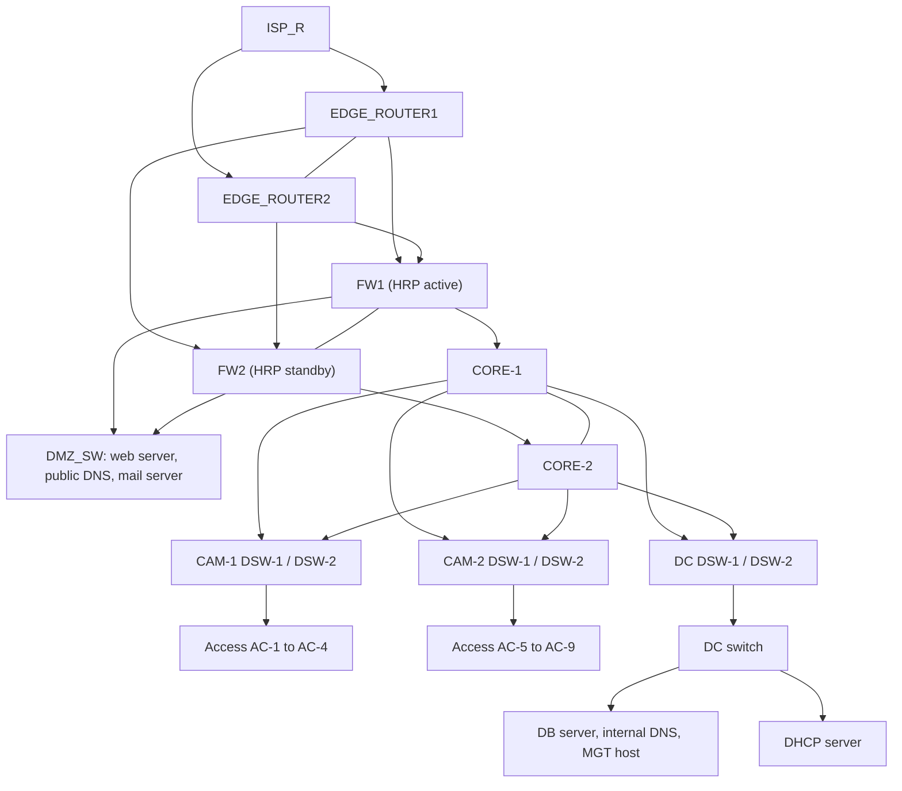

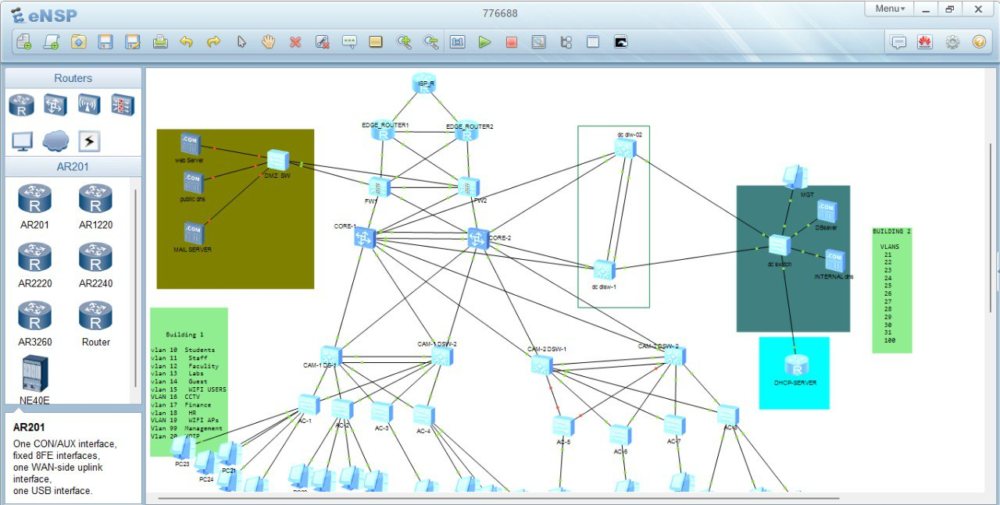
*Figure 1: Full eNSP topology: ISP, edge routers, NGFW pair, core, distribution, access, DMZ and data center.*

### Tiers

| Tier | Devices | Role |
|---|---|---|
| **ISP and Edge** | ISP_R, EDGE_ROUTER1, EDGE_ROUTER2 | Dual-homed internet egress, VRRP, floating static routes |
| **Security** | FW1, FW2 (USG6000V) | HRP cluster, Trust / Untrust / DMZ zones, NAT, port forwarding, stateful inspection |
| **Core** | CORE-1, CORE-2 | OSPF Area 0 backbone, Eth-Trunk interconnect |
| **Distribution** | CAM-1 DSW-1/2, CAM-2 DSW-1/2, DC DSW-1/2 | VRRP gateways, VLAN SVIs, ACL enforcement, aggregation |
| **Access** | AC-1 to AC-9 | End-user ports, Layer 2 security |
| **DMZ (2-tier)** | DMZ_SW, web server, public DNS, mail server | Public services behind the firewalls |
| **Data center (2-tier)** | DC switch, DB server, internal DNS, management host, DHCP server | Internal services |

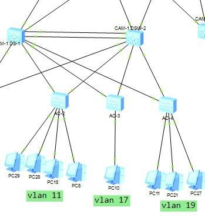
*Figure 2: VLAN segmentation at the access layer.*

| Access switch | Example VLAN in the lab |
|---|---|
| AC-2 | VLAN 11 (Staff) |
| AC-3 | VLAN 17 (Finance) |
| AC-4 | VLAN 19 (Wi-Fi APs) |

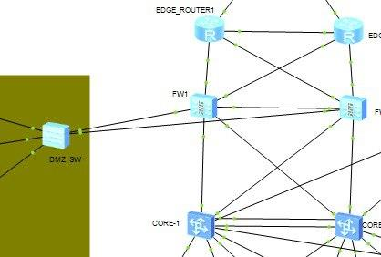
*Figure 3: Edge routers, NGFW pair, DMZ switch and core.*

### Platforms

| Role | Platform |
|---|---|
| Edge routers | Huawei AR series |
| Firewalls | Huawei USG6000V |
| Core and distribution | Huawei S5700 / S6700 class |
| Access | Huawei S2700 / S3700 class |

---

## 4. VLAN and IP Addressing

Full tables: [`docs/IP_VLAN_Addressing_Plan.md`](docs/IP_VLAN_Addressing_Plan.md)

| VLAN | Name | Subnet | VRRP VIP |
|---|---|---|---|
| 10 | Students | 192.168.10.0/24 | 192.168.10.254 |
| 11 | Staff | 192.168.11.0/24 | 192.168.11.254 |
| 12 | Faculty | 192.168.12.0/24 | 192.168.12.254 |
| 13 | Labs | 192.168.13.0/24 | 192.168.13.254 |
| 14 | Guest | 192.168.14.0/24 | 192.168.14.254 |
| 15 | Wi-Fi Users | 192.168.15.0/24 | 192.168.15.254 |
| 16 | CCTV | 192.168.16.0/24 | 192.168.16.254 |
| 17 | Finance | 192.168.17.0/24 | 192.168.17.254 |
| 18 | HR | 192.168.18.0/24 | 192.168.18.254 |
| 19 | Wi-Fi APs | 192.168.19.0/24 | 192.168.19.254 |
| 20 | VoIP | 192.168.20.0/24 | 192.168.20.254 |
| 99 | Management | 192.168.99.0/24 | 192.168.99.254 |
| 21 to 31, 100 | Building 2 and data center | see addressing plan | see addressing plan |

---

## 5. Technologies Implemented

**VRRP (gateway redundancy).** CAM-1 DSW-1 is Master and DSW-2 is Backup for all 12 Building 1 gateways (VRID equals VLAN ID, VIP ends in .254). On the edge, EDGE_ROUTER1 is Master (priority 120, preempt delay 20 s) for VIP 10.12.12.14.

**OSPF.** Process 1, Area 0. CORE-1 (router-ID 1.1.1.1) shows 8 neighbors, all in Full state, including the Eth-Trunk1 adjacency to CORE-2. VLAN subnets are learned through OSPF at remote devices.

**LACP / Eth-Trunk.** `lacp-static` bundles of two GE ports. Verified on CAM-1 DSW-1/2: Eth-Trunk2 up, two members selected, SIP-XOR-DIP hashing.

**NGFW high availability (HRP).** FW1 (active, priority 100) and FW2 (standby, priority 90). Zones: Trust, Untrust, DMZ. NAT and stateful inspection at the edge. **Port forwarding** publishes the DMZ web server to the internet.

**Edge redundancy.** Two edge routers with floating static routes for automatic internet failover.

**DHCP.** Centralized server with relay agents. A VLAN 12 test host received 192.168.12.253/24, gateway 192.168.12.254, DNS 172.16.220.4 and 8.8.8.8.

**Spanning tree.** Rapid PVST+ / RSTP with edge ports and BPDU protection on access ports.

---

## 6. Security Design

Full policy: [`docs/Security_Policy.md`](docs/Security_Policy.md)

### Defense in depth

| Layer | Control | Status |
|---|---|---|
| Perimeter | NGFW zones (Trust / Untrust / DMZ), NAT, stateful inspection | Evidence in repo (HRP, DMZ reachability) |
| Perimeter | Port forwarding to DMZ web services and applications | Design documented, screenshot to be added |
| Inter-VLAN | Role-based ACLs | Policy documented, enforcement screenshots to be added |
| Layer 2 | Port security | Described in report, screenshot to be added |
| Layer 2 | STP edge ports and BPDU protection | Edge ports in report, BPDU screenshot to be added |
| Layer 2 | DHCP snooping and DHCP binding table | Design documented, screenshot to be added |
| Layer 2 | Dynamic ARP Inspection (DAI) | Design documented, screenshot to be added |

### Inter-VLAN access policy

| Role (VLAN) | Permitted | Denied |
|---|---|---|
| Students (10) | Internet, DNS, DHCP, Labs (13) | Staff, Faculty, Finance, HR, Management, database servers |
| Staff (11) | Internet, DNS, DHCP, database servers | Other sensitive VLANs |
| Faculty (12) | Internet, DNS, DHCP, database servers, Labs, Management | Finance and HR unless authorized |
| Guest (14) | Internet, DNS | All internal VLANs |
| Wi-Fi Users (15) | Internet, DNS | All internal VLANs |
| Finance (17), HR (18) | Internet, DNS, DHCP, database servers, Management | Other sensitive VLANs without authorization |
| Management (99) | All VLANs and servers | None |

### Layer 2 attack mitigation

| Threat | Mitigation |
|---|---|
| Rogue DHCP server | DHCP snooping with trusted uplinks only |
| ARP spoofing | DAI validated against the snooping binding table |
| MAC flooding, unauthorized devices | Port security |
| Rogue switch, STP manipulation | Edge ports with BPDU protection |

Principles: segmentation by role and data sensitivity, least privilege, defense in depth.

---

## 7. Quality of Service

| Priority | VLANs |
|---|---|
| Control | Management (99) |
| High | CCTV (16), Finance (17), HR (18) |
| Medium | Staff (11), Faculty (12), Labs (13), Wi-Fi APs (19) |
| Low | Students (10), Guest (14), Wi-Fi Users (15) |

---

## 8. Simulation Environment

| Tool | Version | Purpose |
|---|---|---|
| Huawei eNSP | 1.3.00.200T | Simulation and device configuration |
| Oracle VirtualBox | 5.2.44 | Runs firewall and router VM images |
| WinPcap | 4.1.3 | Packet capture driver |
| Wireshark | 3.6.10 | Protocol analysis (ICMP, OSPF, VRRP) |

---

## 9. Validation and Test Results

Full list: [`docs/Test_Plan_and_Results.md`](docs/Test_Plan_and_Results.md)

| # | Test | Result | Evidence |
|---|---|---|---|
| 1 | OSPF neighbors on CORE-1 | 8 of 8 Full | 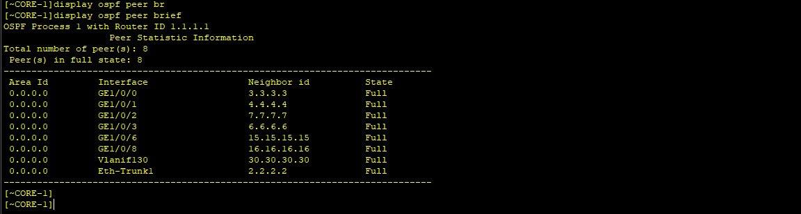 |
| 2 | OSPF routes learned | VLAN subnets present | 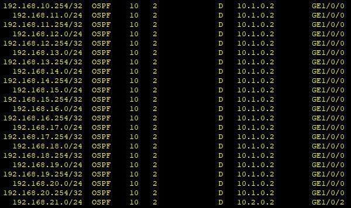 |
| 3 | Edge VRRP | R1 Master, R2 Backup | 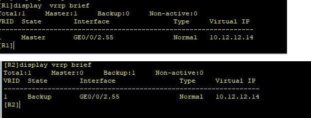 |
| 4 | Distribution VRRP | DSW-1 Master, DSW-2 Backup, 12 VLANs | 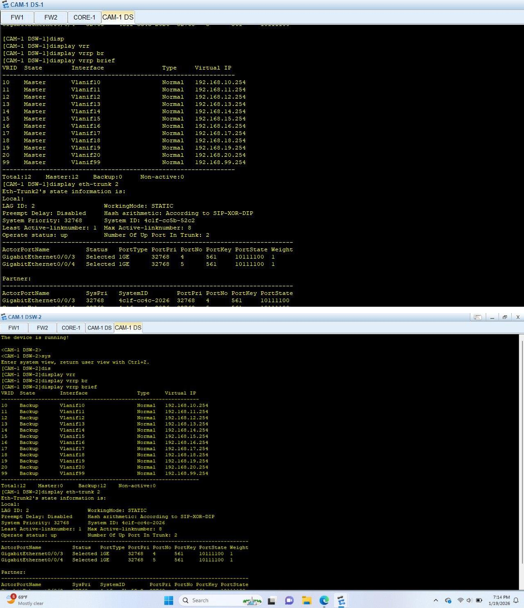 |
| 5 | Eth-Trunk / LACP | Up, 2 ports selected |  |
| 6 | Firewall HRP, steady state | FW1 active, FW2 standby | 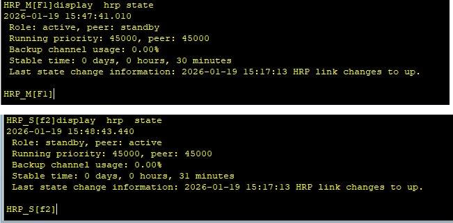 |
| 7 | Firewall failover | FW1 shut down, FW2 took over | 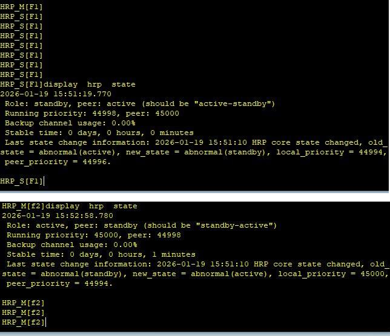 |
| 8 | DHCP | Address, gateway, DNS received | 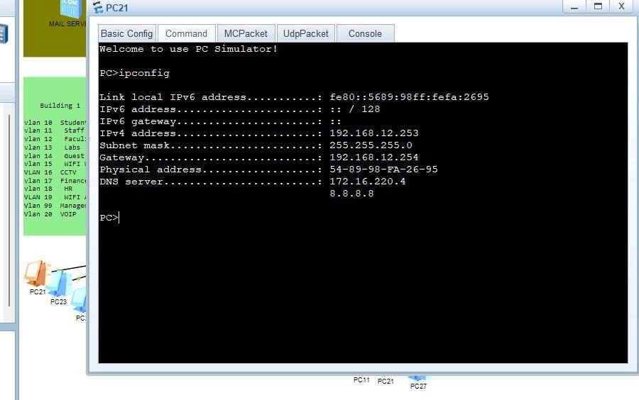 |
| 9 | End-to-end ping | 5 of 5 replies, 0% loss | 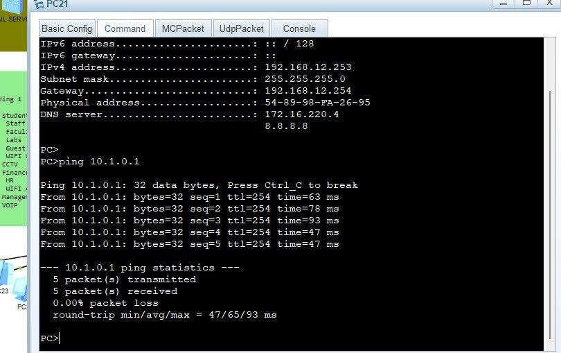 |
| 10 | Internet to DMZ web server | HTTP response from 197.156.10.10:80 | 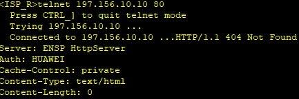 |
| 11 | Firewall resources | CPU about 23%, memory 65% | 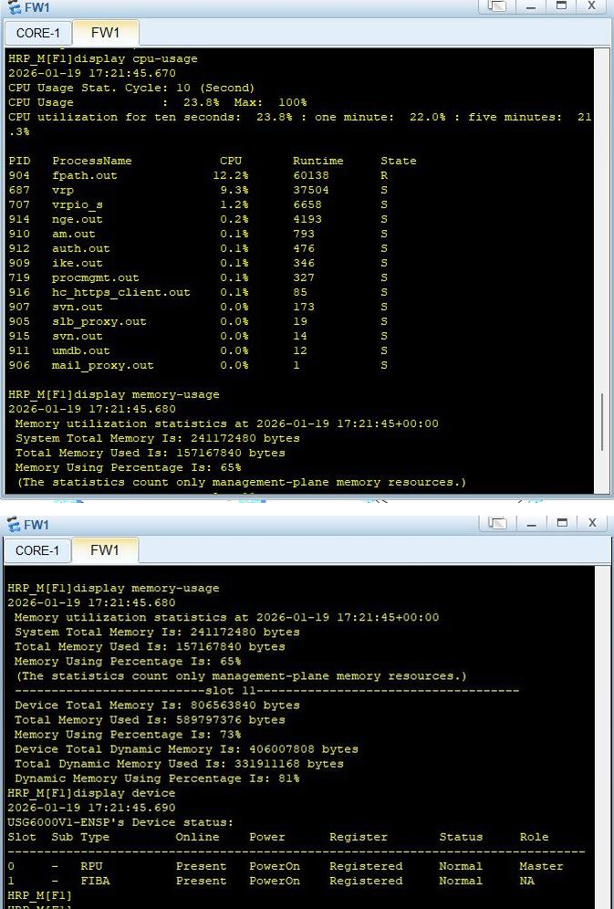 |

---

## 10. My Contribution

I designed the logical topology of the campus network and configured its routing, redundancy and security services. On the routing and redundancy side, I configured OSPF, VRRP gateways and the virtual floating IP address on the edge routers. On the security side, I configured the access-layer security measures, ACLs, firewall zones and firewall policies, NAT with PAT overload, and port forwarding for the DMZ. I also configured QoS across the network.

---

## 11. Repository Structure

```text
.
├── README.md
├── LICENSE
├── docs/            # Addressing plan, security policy, test plan
├── topology/        # eNSP diagrams
├── screenshots/     # Evidence by feature (routing, redundancy, security, firewall, services, qos)
└── configs/         # Sample configurations from the project report
```

---

## 12. Future Work

- Rebuild the topology from this documentation and archive the `.topo` and full `display current-configuration` output
- Add ACL permit/deny, DHCP snooping, DAI and port-forwarding evidence screenshots
- 802.1X / AAA on access ports
- Wireless controller integration
- Configuration backup automation (Python or Ansible)
- IPv6 dual-stack readiness

---

## 13. Credits and License

Group internship project, Mekelle Institute of Technology, Information Technology. Thanks to the Network Infrastructure Team of the ICT Directorate, Mekelle University, and to advisors Hzbawit and Ms. Meaza.

Released under the [MIT License](LICENSE). Shared for educational purposes.
